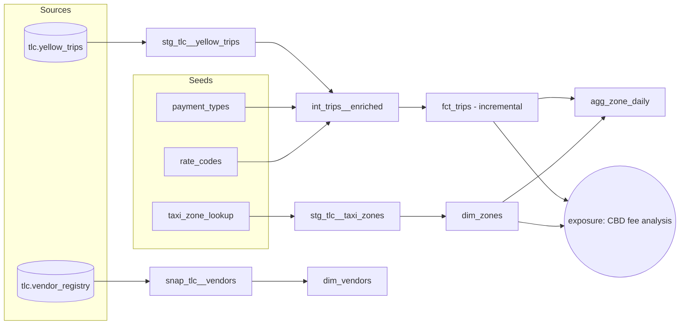

# AI Agentic dbt Development: Crash Course Plan

Suggestions for the brief in `README.md`. Status: **draft for review**. Nothing has been built or recorded yet.

**Docs version: dbt v1.** Every docs link uses `?version=1`. The course is organized around the building blocks listed on [About dbt projects (v1)](https://docs.getdbt.com/docs/build/projects?version=1). See §5, the blocks map.

---

## 1. The idea

A presenter with a mic shares their screen and builds **one real dbt project**, from an empty folder to production patterns. Every section has the same rhythm:

```
Slide (1-2 min)  ->  dbt docs on screen (2-4 min)  ->  Build in Rosetta dbt Studio (5-10 min)  ->  Verify (1-2 min)  ->  Checkpoint
                                                     editor by hand + AI chat
```

The project uses **NYC TLC Yellow Taxi trip records**. The data is real, public and messy, and it produces on its own the problems that make dbt's features make sense: nulls, negative fares, trips that end before they start, a lookup CSV, a data dictionary, monthly files, and a new column that appeared in January 2025.

**How it differs from the Beginners Course** (`../Rosetta-DBT-Studio-Beginners-Course`):

| | Beginners Course | This crash course |
|---|---|---|
| Voice | TTS voiceover over slides | Live human, mic + screen share |
| Data | `university_sample.duckdb` (synthetic, 100 students) | NYC taxi (millions of real rows) |
| Driver | Rosetta generators + UI tour | dbt v1 docs + AI agent, with the human reviewing |
| Assumes | Nothing | Lessons 3-4 done: app installed, interface known |

---

## 2. Why NYC taxi data

| Course need | What the dataset gives |
|---|---|
| Real and public | Published monthly by the NYC Taxi & Limousine Commission. No sign-up needed. |
| Laptop-sized | Each month is one Parquet file, about 3-4M rows and about 50-60 MB. DuckDB builds the whole project in seconds. |
| **Sources** | Trip files loaded into a `raw` schema |
| **Seeds** | Official `taxi_zone_lookup.csv` (265 zones), plus code lists from the data dictionary |
| **Documentation** | An official data dictionary (yellow taxi, dated 18 Mar 2025) gives descriptions for every column |
| **Tests that really fail** | Null blocks, negative amounts, zero-distance trips, pickups outside the file's month |
| **Incremental** | One file per month, so "a new month arrives" is real |
| **Schema change** | `cbd_congestion_fee` (MTA Congestion Relief Zone, from 5 Jan 2025) exists only from the January 2025 file onward |
| **Snapshots** | The dictionary's vendor list really changed. Older versions list VendorID 2 as *VeriFone Inc.*; the 2025 version lists *Curb Mobility, LLC* and adds 6 = Myle and 7 = Helix. |
| **Capstone question** | "How much CBD congestion fee was collected in January 2025, and where?" |

**Months:** start with **Nov 2024 + Dec 2024**, then add **Jan 2025** in Section 10 so the new column arrives on camera.

**Attribution** (on the S1 slide and in the repo README): *Data: NYC Taxi & Limousine Commission, TLC Trip Record Data.*

**Alternatives considered:**
- University sample: continuity with the Beginners Course, but too small and too clean to make tests fail.
- Jaffle Shop: synthetic, and already in two of your videos.
- Olist e-commerce: rich, but licensed CC BY-NC-SA. Check that before using it on a commercial channel.

---

## 3. The agentic habits (repeat every section)

Put these six habits on a slide in S0 and show them as a footer strip on every Prompt card:

1. **Context over memory.** Give the agent files (the data dictionary, the skill). Don't rely on what it remembers.
2. **Plan before act.** For multi-file work, ask for the plan first and approve it.
3. **One task per chat.** Start a new chat each section and keep an eye on the context ring.
4. **Read every diff before you Keep it.** The review is the lesson.
5. **dbt is the judge.** Run, test and look at the rows. When the agent says "done", that is a claim, not proof.
6. **If you correct the agent twice, add it to the skill.**

**Hand vs. agent rule:** the first time a concept appears, the presenter writes a small example **by hand**, so the viewer learns dbt rather than just watching an agent. The bulk and repetitive work goes to the **agent** after that, and the human reviews it.

---

## 4. What we build



```
nyc_taxi/
├── dbt_project.yml
├── packages.yml                       # dbt_utils
├── reference/
│   └── tlc_yellow_data_dictionary.md  # the agent's ground truth
├── scripts/
│   └── load_raw.sql                   # the "EL" step, outside dbt
├── data/                              # Parquet files (gitignored)
├── seeds/
│   ├── taxi_zone_lookup.csv
│   ├── payment_types.csv
│   ├── rate_codes.csv
│   └── _seeds.yml
├── models/
│   ├── staging/tlc/
│   │   ├── _tlc__sources.yml
│   │   ├── stg_tlc__yellow_trips.sql / .yml
│   │   └── stg_tlc__taxi_zones.sql / .yml
│   ├── intermediate/
│   │   ├── int_trips__enriched.sql
│   │   ├── _int__models.yml
│   │   └── _int__unit_tests.yml
│   ├── marts/
│   │   ├── fct_trips.sql
│   │   ├── dim_zones.sql
│   │   ├── dim_vendors.sql
│   │   ├── agg_zone_daily.sql
│   │   ├── _marts__models.yml
│   │   └── _exposures.yml
│   └── docs.md                        # doc blocks
├── snapshots/snap_tlc__vendors.yml
├── macros/safe_divide.sql
├── analyses/payment_mix.sql
└── tests/assert_trip_ends_after_it_starts.sql
```

---

## 5. Blocks map: About dbt projects (v1)

The [About dbt projects (v1)](https://docs.getdbt.com/docs/build/projects?version=1) page lists every building block of a dbt project in two tables. This map is the course's table of contents. Show it as a slide in S2 and tick blocks off in each Recap.

**Resources table**

| Block | Section | In our project |
|---|---|---|
| [models](https://docs.getdbt.com/docs/build/models?version=1) | S5 staging, S8 intermediate & marts, S10 incremental | `stg_`, `int_`, `fct_`, `dim_`, `agg_` |
| [sources](https://docs.getdbt.com/docs/build/sources?version=1) | S3 | `tlc.yellow_trips`, `tlc.vendor_registry` |
| [seeds](https://docs.getdbt.com/docs/build/seeds?version=1) | S4 | `taxi_zone_lookup`, `payment_types`, `rate_codes` |
| [data tests](https://docs.getdbt.com/docs/build/data-tests?version=1) | S6 (unit tests in S9) | generic + singular tests |
| [macros](https://docs.getdbt.com/docs/build/jinja-macros?version=1) | S7 | `safe_divide`, plus `dbt_utils` |
| [analysis](https://docs.getdbt.com/docs/build/analyses?version=1) | S7 | `analyses/payment_mix.sql` |
| [snapshots](https://docs.getdbt.com/docs/build/snapshots?version=1) | S11 | `snap_tlc__vendors` |
| [docs](https://docs.getdbt.com/docs/build/documentation?version=1) | S12 | descriptions, doc blocks, docs site |
| [exposures](https://docs.getdbt.com/docs/build/exposures?version=1) | S12 | the CBD fee analysis |
| [metrics](https://docs.getdbt.com/docs/build/build-metrics-intro?version=1), [semantic models](https://docs.getdbt.com/docs/build/semantic-models?version=1), [saved queries](https://docs.getdbt.com/docs/build/saved-queries?version=1) | Not covered | Candidate Part 3 (Semantic Layer) |
| [groups](https://docs.getdbt.com/docs/build/groups?version=1) | Not covered | Candidate Part 3 (with model access and contracts) |
| [user-defined functions](https://docs.getdbt.com/docs/build/udfs?version=1) | Not covered | Candidate Part 3. Check dbt-duckdb support first. |

**Project configuration table** (all shown in `dbt_project.yml` during S2)

| Key | Section | How we use it |
|---|---|---|
| `name`, `version`, `profile` | S2 | `nyc_taxi`, connected to the DuckDB profile |
| `require-dbt-version` | S2 | Pin the project to a range of dbt v1 versions, as the page describes |
| `model-paths`, `seed-paths`, `test-paths`, `analysis-paths`, `macro-paths`, `snapshot-paths`, `docs-paths` | S2 | Keep the defaults; show where each block lives in the folder tree |
| [`vars`](https://docs.getdbt.com/docs/build/project-variables?version=1) | S10 | `lookback_days` for the incremental filter |

---

## 6. Course map

All docs links are v1 (`?version=1`).

**Part 1: Core** (about 95 min)

| # | Section | dbt docs on screen | Studio features shown | Real-data moment | Min |
|---|---|---|---|---|---|
| 0 | Welcome & the agentic loop | [Introduction](https://docs.getdbt.com/docs/introduction?version=1) | New project, AI chat (Ask / Code), Keep / Discard | - | 6 |
| 1 | Load the real data: dbt is the "T" | Introduction (ELT) + TLC data dictionary | SQL Editor AI, DDL approval gate, Ask-mode profiling | Dirty rows found | 10 |
| 2 | Project anatomy & teaching the agent | [About dbt projects](https://docs.getdbt.com/docs/build/projects?version=1), [How we structure](https://docs.getdbt.com/best-practices/how-we-structure/1-guide-overview?version=1) | Skills Library, MCP servers | - | 10 |
| 3 | Sources | [Sources](https://docs.getdbt.com/docs/build/sources?version=1) | Rosetta Raw Layer, agent edits YAML from the dictionary | Guessed `not_null` tests fail | 10 |
| 4 | Seeds | [Seeds](https://docs.getdbt.com/docs/build/seeds?version=1) | Agent writes CSVs, terminal confirm | Payment type 0 = Flex Fare | 8 |
| 5 | Staging models | [SQL models](https://docs.getdbt.com/docs/build/sql-models?version=1), [Staging guide](https://docs.getdbt.com/best-practices/how-we-structure/2-staging?version=1) | Model run buttons, Preview, Compiled SQL tab, lineage | - | 12 |
| 6 | Data tests | [Data tests](https://docs.getdbt.com/docs/build/data-tests?version=1) | Run History error view + AI assistant fix | Trips that end before they start | 12 |
| 7 | Packages, Jinja, macros & analyses | [Packages](https://docs.getdbt.com/docs/build/packages?version=1), [Jinja & macros](https://docs.getdbt.com/docs/build/jinja-macros?version=1), [Analyses](https://docs.getdbt.com/docs/build/analyses?version=1) | Agent runs `dbt deps`, Compiled SQL tab | Trips have no primary key | 12 |
| 8 | Intermediate, marts & materializations | [Intermediate](https://docs.getdbt.com/best-practices/how-we-structure/3-intermediate?version=1), [Marts](https://docs.getdbt.com/best-practices/how-we-structure/4-marts?version=1), [Materializations](https://docs.getdbt.com/docs/build/materializations?version=1) | Plan-then-act, multi-file Keep, lineage DAG, `dbt build` | Duplicates / invalid trip counts | 15 |

**Part 2: Production patterns** (about 52 min)

| # | Section | dbt docs on screen | Studio features shown | Real-data moment | Min |
|---|---|---|---|---|---|
| 9 | Unit tests | [Unit tests](https://docs.getdbt.com/docs/build/unit-tests?version=1) | Agent writes test YAML from plain-English edge cases | Zero-distance trip divides by zero | 10 |
| 10 | Incremental models & a schema change | [Incremental models](https://docs.getdbt.com/docs/build/incremental-models?version=1), [Project variables](https://docs.getdbt.com/docs/build/project-variables?version=1) | Ask-mode explain, Run History row counts | `cbd_congestion_fee` appears | 15 |
| 11 | Snapshots | [Snapshots](https://docs.getdbt.com/docs/build/snapshots?version=1) | Approval gate for DML, `dbt snapshot` via agent | VeriFone becomes Curb Mobility | 10 |
| 12 | Docs, lineage & exposures: the capstone | [Documentation](https://docs.getdbt.com/docs/build/documentation?version=1), [Exposures](https://docs.getdbt.com/docs/build/exposures?version=1) | `dbt docs generate/serve`, Ask-mode lineage tracing, Analytics / Dive | CBD fee answer | 12 |
| 13 | Wrap-up & what's next | - | - | - | 5 |

**Total:** about 2.5 hours of finished video. You can publish it as one course or as two playlists (Part 1 and Part 2).

---

## 7. Sections in detail

Prompts are written exactly as the presenter should paste them. Keep each one in `prompts/sNN.md` and show the same text on that section's Prompt card slide.

### S0: Welcome & the agentic loop (6 min)

**Goal:** the viewer knows what they will build, how the screen is laid out, and the six habits.

**Slides**
1. Title
2. What you'll build: the final DAG, plus a teaser of the capstone chart
3. The agentic loop: Prompt → Plan → Act → **Review** → Run → Verify
4. The six habits
5. The screen: file tree | editor | AI chat; Ask vs Code mode; Keep / Discard; terminal Allow / Deny

**Docs walk**
- [Introduction](https://docs.getdbt.com/docs/introduction?version=1). Show the "dbt transforms data already in your warehouse" idea and the list of what dbt adds (models as `select`, `ref`, tests, docs).
- Point at the version picker and say once that the course follows the **v1** docs, the version Rosetta dbt Studio runs.

**Build (by hand)**
- New project `nyc_taxi` with a **DuckDB** connection to a new file, `nyc_taxi.duckdb`.
- Show where the AI provider, Skills and MCP settings live. Just point at them for now.
- Say the versions once on screen: app version, dbt-core (1.x), dbt-duckdb, and the AI model.

**Verify:** run `dbt debug` from the Project menu and show it green.

**Checkpoint:** `s00-end`

---

### S1: Load the real data: dbt is the "T" (10 min)

**Goal:** raw data sits in DuckDB, and we know what's wrong with it before writing any model.

**Slides**
1. ELT diagram: TLC files → `raw` schema in DuckDB → dbt
2. Dataset card: columns, months, row counts, attribution
3. "What we found" (filled in from this section's profile)

**Docs walk**
- The ELT paragraph in the dbt Introduction.
- The TLC data dictionary PDF. Make the point that **the source system's docs are docs too.**

**Build (by hand), prepped before recording**
- The Parquet files are already in `data/`.
- `reference/tlc_yellow_data_dictionary.md` is already written: the dictionary transcribed to Markdown, including every code list. Open it on screen. The agent will read this file all course long.

**Build (AI): SQL Editor AI panel, Code mode**

> In the DuckDB connection, create a schema called raw. Load data/yellow_tripdata_2024-11.parquet and data/yellow_tripdata_2024-12.parquet into a table raw.yellow_trips using read_parquet with union_by_name and filename = true, so every row keeps the file it came from. Show me the SQL before you run it.

- **Watch for:** the approval gate on DDL. Read the SQL aloud, then click Allow.
- Save the SQL as `scripts/load_raw.sql`. It gets re-run in S10. The fallback version is in Appendix A.

**Build (AI): Ask mode**

> Profile raw.yellow_trips: rows per source file, the pickup date range, null count per column, and how many rows have fare_amount < 0, trip_distance = 0, or dropoff before pickup. One query per question, and show the numbers in a table.

**Real-data moment:** write the findings onto slide 3: pickups outside the file's month, negative fares, zero-distance trips, a block of rows with null `passenger_count` / `RatecodeID`, and trips that end before they start. Then say: *"We'll come back to every one of these."*

**Checkpoint:** `s01-end`

---

### S2: Project anatomy & teaching the agent your conventions (10 min)

**Goal:** the viewer knows the building blocks and the three layers, and the agent knows our rules.

**Slides**
1. The blocks map from §5: every block on the page, and the section that builds it
2. Staging → Intermediate → Marts, using **our** model names
3. "Docs → Skill → Agent": what we read becomes what the agent follows

**Docs walk**
- [About dbt projects (v1)](https://docs.getdbt.com/docs/build/projects?version=1):
  - the **resources table**: the blocks we will build, one by one
  - the **project configuration table**: the keys we are about to set
- [How we structure our dbt projects](https://docs.getdbt.com/best-practices/how-we-structure/1-guide-overview?version=1): source-conformed → business-conformed, and the folder tree.

**Build (by hand):** walk `dbt_project.yml` against the configuration table.
- `name`, `version` and `profile`
- `require-dbt-version` restricted to a dbt v1 range, for example `[">=1.10.0", "<2.0.0"]`
- the `*-paths` keys, left at their defaults: show where each block lives in the folder tree
- folder-level materializations:
  - staging: `view`
  - intermediate: `view` (mention `ephemeral` as the other common choice; a view can be previewed and unit-tested in S9)
  - marts: `table`

Then create the folders.

**Build (AI): Skills Library**
- Create the skill `nyc-taxi-dbt-conventions`. The text is in Appendix B.
- Option: in Ask mode, have the agent draft it from the structure guide, then edit it by hand on camera.
- Mention that skills are app-wide (they live in the app's skills folder), not per project.

**Build (AI): MCP servers panel**
- Show the built-in dbt Core server.
- Optionally add `https://gitmcp.io/dbt-labs/docs.getdbt.com` so the agent reads the **same docs we read**. Check that this works during prep.
- Test it in Ask mode:

> Using the dbt v1 docs, what is the difference between a source and a seed? Three bullets, and name the page you used.

**Checkpoint:** `s02-end`

---

### S3: Sources (10 min)

**Goal:** `raw.yellow_trips` is declared as `source('tlc', 'yellow_trips')`, documented from the dictionary, with tests that match reality.

**Slides**
1. What a source is
2. `source()` vs. hard-coded table names
3. Tests and freshness on sources

**Docs walk:** [Sources](https://docs.getdbt.com/docs/build/sources?version=1). Cover declaring a source in YAML, selecting from it with `{{ source() }}`, and testing it. Mention freshness (`dbt source freshness` in v1), and say we skip it because this data is historical: it would always be "stale".

**Build (Rosetta, no AI):** Project → **Raw Layer**. This generates the source YAML from DuckDB with a `not_null` test on every column, exactly as in Beginners lesson 7.
- **Option B**, if Rosetta is unreliable on the recording machine: have the agent write the source YAML from the table schema.

**Build (AI): Code mode**

> Move the generated source YAML to models/staging/tlc/_tlc__sources.yml. Name the source tlc and keep the table name yellow_trips. Add a description to every column from reference/tlc_yellow_data_dictionary.md, including the full code lists for VendorID, RatecodeID and payment_type. Don't change the tests yet.

**Review on camera:** spot-check two descriptions against the PDF, then Keep.

**Verify:** `dbt test --select source:tlc`. Several `not_null` tests fail.

**Real-data moment:** follow up in Ask mode:

> Which rows fail the not_null test on passenger_count? What do they have in common?

If your dry run confirms it, the answer is that these rows carry `payment_type = 0` (Flex Fare). The decision: drop the guessed `not_null` tests on those columns, and keep them on pickup/dropoff time and location IDs.

**Checkpoint:** `s03-end`

---

### S4: Seeds (8 min)

**Goal:** lookup data lives in version-controlled CSVs.

**Slides**
1. Seeds: what they are good for and not good for
2. Our three seeds

**Docs walk:** [Seeds](https://docs.getdbt.com/docs/build/seeds?version=1). Show "static data that changes infrequently", the good and bad use cases, and `column_types`.

**Build (by hand):** download the official `taxi_zone_lookup.csv` from TLC into `seeds/` and open it (265 rows).

**Build (AI): Code mode**

> Create two seeds from reference/tlc_yellow_data_dictionary.md: seeds/payment_types.csv (payment_type_id, payment_type_name) and seeds/rate_codes.csv (rate_code_id, rate_code_name). Include every code in the dictionary. Add seeds/_seeds.yml with descriptions, and column_types so the ids are integers. Then run dbt seed.

- **Watch for:** the terminal confirm on `dbt seed`.

**Review moment:** `payment_types` must include **0 = Flex Fare** and **6 = Voided trip**, and `rate_codes` must include **99**. Older lists that a model might "remember" stop at 1-6. This is habit #1 (context over memory) proving itself.

**Verify:** `select * from payment_types` in the SQL editor.

**Checkpoint:** `s04-end`

---

### S5: Staging models (12 min)

**Goal:** clean, renamed, typed building blocks, one per source table.

**Slides**
1. A model is a `select`
2. `ref()` builds the DAG
3. Staging rules: rename, recast, no joins, no filters

**Docs walk**
- [SQL models](https://docs.getdbt.com/docs/build/sql-models?version=1)
- [Staging guide](https://docs.getdbt.com/best-practices/how-we-structure/2-staging?version=1): naming `stg_[source]__[entity]s`, and what belongs in staging and what doesn't

**Build (by hand):** `models/staging/tlc/stg_tlc__taxi_zones.sql` from `ref('taxi_zone_lookup')`. Rename `LocationID` → `location_id`, `Borough` → `borough`, `Zone` → `zone_name`, and keep `service_zone`. Run it with the model button, open Preview, then open the **Compiled SQL** tab to show what `ref` turned into.

**Build (AI): Code mode**

> Following the nyc-taxi-dbt-conventions skill, create stg_tlc__yellow_trips from source('tlc', 'yellow_trips'). Rename every column to snake_case, timestamps end in _at, store_and_fwd_flag becomes a boolean, money columns are decimal(10,2), and keep the source filename as source_file. No filters, no joins. Add stg_tlc__yellow_trips.yml with descriptions taken from the source YAML. Then build only this model.

- **Watch for:** the agent reads the skill and the source YAML, the files open as tabs, and it asks to run `dbt build --select stg_tlc__yellow_trips` (click Allow).
- **Review:** check the casts and that there is **no** `where` clause. The dirty rows stay in staging for now.

**Verify:** the lineage view shows source → staging, and Preview shows 100 rows.

**Checkpoint:** `s05-end`

---

### S6: Data tests (12 min)

**Goal:** encode what we expect, watch real data break it, and decide what to do.

**Slides**
1. Generic tests: unique, not_null, accepted_values, relationships
2. Singular tests
3. Severity: warn vs. error. A test failure is a decision, not a bug.

**Docs walk:** [Data tests](https://docs.getdbt.com/docs/build/data-tests?version=1). Cover generic vs. singular tests, the `data_tests:` key in YAML, the `severity` and `where` configs, and `store_failures`.

**Build (by hand):** add `unique` + `not_null` to `stg_tlc__taxi_zones.location_id`.

**Build (AI): Code mode**

> In stg_tlc__yellow_trips.yml add: not_null on pickup_at and dropoff_at; accepted_values on payment_type_id using the codes in seeds/payment_types.csv; relationships from pickup_location_id and dropoff_location_id to stg_tlc__taxi_zones.location_id. Write a singular test, tests/assert_trip_ends_after_it_starts.sql. Run dbt test for this model only.

**Real-data moment**
1. The singular test fails.
2. Open **Run History → error view → AI assistant** and let it propose a fix.
3. The human makes the call: we don't delete facts in staging. Set this test to `severity: warn`, turn on `store_failures: true`, and query the failing rows.
4. Close with: *"We'll flag these as invalid in the intermediate layer in S8."*

**Checkpoint:** `s06-end`

---

### S7: Packages, Jinja, macros & analyses (12 min)

**Goal:** reuse other people's code, write our own reusable SQL, and see what Jinja compiles to.

**Slides**
1. Packages: dbt's library system
2. `{{ }}` vs. ``
3. Macro = function
4. Analyses: SQL that compiles but never builds a table

**Docs walk**
- [Packages](https://docs.getdbt.com/docs/build/packages?version=1): `packages.yml`, `dbt deps`, hub.getdbt.com
- [Jinja & macros](https://docs.getdbt.com/docs/build/jinja-macros?version=1)
- [Analyses](https://docs.getdbt.com/docs/build/analyses?version=1)

**The problem:** taxi trips have **no primary key**.

**Build (AI): Code mode**

> Add dbt-labs/dbt_utils to packages.yml, choosing the latest version compatible with my dbt version, and run dbt deps.

- **Watch for:** the terminal confirm. Then check the version on hub.getdbt.com. That's the docs habit again.

**Build (AI): Ask mode**

> Explain what dbt_utils.generate_surrogate_key does, and which columns of stg_tlc__yellow_trips together could identify a trip. Don't write code.

**Build (by hand)**
- `macros/safe_divide.sql`: about 6 lines that return null when the denominator is 0. It's needed for fare per mile, because of zero-distance trips.
- `analyses/payment_mix.sql`: a small `` loop over two payment types. Compile it and show the **Compiled SQL** tab. Point out that an analysis compiles but never creates a table.

**Build (AI): Code mode**

> Change analyses/payment_mix.sql so the list of payment types comes from the payment_types seed using dbt_utils.get_column_values instead of a hard-coded list. Compile it.

**Checkpoint:** `s07-end`

---

### S8: Intermediate, marts & materializations (15 min). End of Part 1

**Goal:** business-ready tables, built by the agent from an approved plan.

**Slides**
1. Intermediate: purpose-built logic
2. Marts: facts, dimensions and aggregates
3. Materializations: view / table / ephemeral / incremental
4. Plan-then-act

**Docs walk**
- [Intermediate](https://docs.getdbt.com/best-practices/how-we-structure/3-intermediate?version=1)
- [Marts](https://docs.getdbt.com/best-practices/how-we-structure/4-marts?version=1)
- [Materializations](https://docs.getdbt.com/docs/build/materializations?version=1)

**Build (AI): Code mode, plan first**

> Before writing any files, propose the intermediate and mart models needed to answer: (1) trips and revenue per pickup zone per day, (2) a clean trip-level fact table. For each model give its grain, its inputs, and its materialization. Wait for my OK.

The human reviews and adjusts the plan on camera, then:

> Go ahead. In int_trips__enriched, build trip_id with dbt_utils.generate_surrogate_key, remove exact duplicates, add trip_duration_minutes, fare_per_mile using the safe_divide macro, an is_valid_trip flag and an invalid_reason column, and join the payment type and rate code names. fct_trips keeps only valid trips. agg_zone_daily pivots trip counts by payment type with a Jinja loop over the payment_types seed. Add YAML with descriptions and primary-key tests for every model, then run dbt build --select +agg_zone_daily.

**Expected models:**
- `int_trips__enriched` (view)
- `dim_zones` (table)
- `fct_trips` (table for now)
- `agg_zone_daily` (table)

**Watch for:** many tool calls. Keep each file only after reading it.

**Verify**
- `dbt build --select +agg_zone_daily`. Show the `+` graph operator from [node selection syntax](https://docs.getdbt.com/reference/node-selection/syntax?version=1).
- The full lineage DAG.
- Run History timings, view vs. table.

**Real-data moment:** in Ask mode, count invalid trips by `invalid_reason`. If the dry run finds duplicates, the `unique` test on `trip_id` shows why the dedup step exists.

**Checkpoint:** `s08-end`

---

### S9: Unit tests (10 min)

**Goal:** lock the business logic with fixed inputs and expected outputs.

**Slides**
1. Data tests check the data; unit tests check the logic
2. given / expect

**Docs walk:** [Unit tests](https://docs.getdbt.com/docs/build/unit-tests?version=1). They need dbt 1.8 or later. Cover `given` / `expect`, the `dict` format, and that you only list the columns you need. Point out the rule that **every** `ref` must be mocked.

**Build: the human states the edge cases in plain English (Code mode)**

> Write unit tests for int_trips__enriched in models/intermediate/_int__unit_tests.yml: (1) trip_distance 0 gives a null fare_per_mile and is_valid_trip false; (2) dropoff before pickup is invalid; (3) a normal 2.5-mile trip with a $15 fare gives fare_per_mile 6.00 and is valid; (4) a negative total_amount is invalid. Mock every ref the model uses. Then run dbt test --select test_type:unit.

**Build (by hand)**
1. Break the logic on purpose: change `>` to `>=`.
2. Run again and watch the test go red.
3. Revert.

**Checkpoint:** `s09-end`

---

### S10: Incremental models & a schema change (15 min)

**Goal:** process only new data, and handle a source that changes shape.

**Slides**
1. Full rebuild vs. incremental
2. `is_incremental()` and `{{ this }}`
3. `on_schema_change`

**Docs walk**
- [Incremental models](https://docs.getdbt.com/docs/build/incremental-models?version=1): `is_incremental()`, `unique_key`, `incremental_strategy`, `on_schema_change` and `--full-refresh`.
- [Project variables](https://docs.getdbt.com/docs/build/project-variables?version=1): the `vars` key from the configuration table in S2.

**Build (AI): Ask mode**

> In four bullets, how would fct_trips behave as an incremental model with unique_key trip_id and the delete+insert strategy? What happens to trips from the last few days of the previous month?

**Build (by hand):** add `vars: {lookback_days: 3}` to `dbt_project.yml`.

**Build (AI): Code mode**

> Make fct_trips incremental: unique_key trip_id, incremental_strategy delete+insert, and on incremental runs only process trips with pickup_at later than the max pickup_at in {{ this }} minus var('lookback_days') days. Leave on_schema_change at its default. Run it once with --full-refresh.

**A new month arrives**
1. Add `yellow_tripdata_2025-01.parquet` to `scripts/load_raw.sql` and re-run it.
2. Run `dbt build --select stg_tlc__yellow_trips+`.
3. Show in Run History that only January rows were processed.

**Real-data moment:** January 2025 brings **`cbd_congestion_fee`**. It's in `raw`, but staging lists its columns explicitly, so it never reaches `fct_trips`.

> The source now has a new column, cbd_congestion_fee (MTA Congestion Relief Zone fee, from 5 January 2025). Add it to reference/tlc_yellow_data_dictionary.md, the source YAML, stg_tlc__yellow_trips, int_trips__enriched and fct_trips. Set on_schema_change on fct_trips so the column is added without a full refresh. Then build.

The column appears, and it is NULL for the November and December rows. Discuss `append_new_columns` vs. `--full-refresh`.

**Checkpoint:** `s10-end`

---

### S11: Snapshots (10 min)

**Goal:** keep history for data that is changed in place (SCD Type 2).

**Slides**
1. Mutable data loses history
2. `dbt_valid_from` / `dbt_valid_to`
3. Timestamp vs. check strategy

**Docs walk:** [Snapshots](https://docs.getdbt.com/docs/build/snapshots?version=1). Use the YAML config, which needs dbt 1.9 or later.

**The story:** a vendor registry. TLC's own dictionary changed: VendorID 2 went from *VeriFone Inc.* to *Curb Mobility, LLC*, and vendors 6 (Myle) and 7 (Helix) were added.

**Build (AI): SQL Editor, Code mode**

> Create raw.vendor_registry (vendor_id, vendor_name) with two rows: 1 = Creative Mobile Technologies, LLC and 2 = VeriFone Inc.

- **Watch for:** the approval gate.

**Build (AI): Code mode**

> Add vendor_registry to the tlc source. Create snapshots/snap_tlc__vendors.yml on source('tlc', 'vendor_registry') with the check strategy on vendor_name and unique_key vendor_id, using the YAML snapshot syntax for my dbt version. Run dbt snapshot.

**Review tip:** agents often write the legacy `` block. Check the syntax against the docs page that's still open.

**The registry changes**
1. In the SQL Editor (approval gate), update vendor 2 to *Curb Mobility, LLC* and insert vendors 6 and 7.
2. Run `dbt snapshot` again.
3. Query the snapshot: vendor 2 now has two rows.
4. Have the agent build `dim_vendors` from the current snapshot rows.

**Checkpoint:** `s11-end`

---

### S12: Docs, lineage & exposures: the capstone (12 min)

**Goal:** the project explains itself, and answers a real question.

**Slides**
1. Docs live next to the code
2. Exposures: who uses this?
3. The capstone question

**Docs walk:** [Documentation](https://docs.getdbt.com/docs/build/documentation?version=1) (descriptions, doc blocks, `dbt docs generate`) and [Exposures](https://docs.getdbt.com/docs/build/exposures?version=1).

**Build (AI): Code mode**

> Create models/docs.md with doc blocks for payment type, rate code and trip validity, and use them in every YAML that describes those columns. Make sure every model and column has a description.

**Verify:** `dbt docs generate` and `dbt docs serve` from the UI. Compare the docs-site lineage with Rosetta's lineage DAG.

**Ask mode: "the project explains itself"**

> Trace cbd_congestion_fee from the source to every model that uses it.

> What is the grain of agg_zone_daily, and can I join it to fct_trips without fan-out?

**Capstone**

> How much CBD congestion fee was collected in January 2025 by pickup borough, and what share of trips paid it?

Answer it from `fct_trips` + `dim_zones` in the **Analytics page or a Dive**, whichever is in the release you record with, and show the chart. Then:

> Declare this analysis as an exposure in models/marts/_exposures.yml that depends on fct_trips and dim_zones.

The exposure then appears in the lineage.

**Checkpoint:** `s12-end`

---

### S13: Wrap-up (5 min)

**Slides**
1. What we built: the DAG, with every section's piece highlighted
2. The blocks map from §5, all ticked
3. The six habits
4. What's next: the blocks we didn't cover (metrics, semantic models, saved queries, groups, UDFs), model contracts, Python models (dbt-duckdb supports them), CI and deploy (link the Rosetta Cloud CI/CD video), and ingestion

---

## 8. Slides per section

Use the same 5-6 slide template for every section, so the series looks like one family. Reuse the Beginners Course `video-presentation.html` style (logo_hero, cards).

1. **Title card:** section number, title, minutes
2. **Concept in one picture**
3. **"The docs say":** three short points plus the v1 docs URL
4. **What we build now:** files plus the DAG with this section's nodes highlighted
5. **Prompt card:** the exact prompt, with the habits strip as a footer
6. **Recap + checkpoint tag:** with the blocks map, this section's block ticked

That comes to about 75 slides for 14 sections. Slides 1, 3 and 6 can be generated from this plan. Slides 2 and 4 need a diagram each.

---

## 9. Recording & prep

**Companion repo with checkpoint tags** (`s00-end` … `s12-end`)
- Each section starts from the previous tag, so a bad take is reset with a checkout instead of a rebuild.
- The DuckDB file and `data/` are gitignored. "Reset to section N" means: checkout the tag, run `scripts/load_raw.sql` (with Jan 2025 only from S10 on), then `dbt build`.

**Prompts as files:** `prompts/s01.md` … paste them on camera, so takes are reproducible and the slide matches.

**AI non-determinism**
- Rehearse every agent step twice with the **exact model** you'll record.
- If the live take deviates but is still reviewable, keep it. Reviewing it is the lesson.
- If it goes off the rails, reset to the checkpoint.

**Pin versions:** app, dbt-core (1.x), dbt-duckdb, dbt_utils, AI provider and model. Show them once in S0.

**Docs tabs:** open every page with `?version=1`. The site remembers the last version you picked, so check the picker before each take.

**Screen**
- 1920×1080, editor zoom 125-150%, one theme throughout.
- No API keys, emails or tokens on screen. Notifications off.
- Run `dbt deps` / `dbt parse` once before recording so the first command isn't slow.

**Editing:** speed up agent waits 2-4x, but never cut the review moment.

**For viewers:** offer two load paths in `scripts/load_raw.sql`:
- local files: reliable, and what you record with
- the TLC URLs directly (`https://d37ci6vzurychx.cloudfront.net/trip-data/yellow_tripdata_YYYY-MM.parquet`): no download step

**Check in the dry run.** These could not be confirmed from here, and each one has a fallback line:

| Item | If it doesn't hold |
|---|---|
| Null `passenger_count` / `RatecodeID` rows have `payment_type = 0` | Say "these rows are incomplete" and skip the Flex Fare reveal |
| Exact duplicate trips exist | The `unique` test passes. Say the dedup is a safety net. |
| Counts of negative-fare, zero-distance and backwards trips | Use whatever the profile shows |
| Rosetta Raw Layer output folder and file names | Adjust the S3 move prompt |
| `gitmcp.io/dbt-labs/docs.getdbt.com` works as an MCP server | Use the built-in dbt Core server only |
| dbt-duckdb applies `on_schema_change` with delete+insert as described (delete+insert itself is documented for dbt-duckdb) | Use `--full-refresh` for the schema change |
| dbt-core version ≥ 1.9 (YAML snapshots), ≥ 1.8 (unit tests) | Upgrade in Settings before recording |
| `dbt snapshot` has no Project-menu button | Run it through the agent or the terminal, as written above |
| Analytics page vs. Dive availability in the recorded release | Pick the one that ships |

---

## 10. Open questions for you

1. **Dataset:** NYC taxi as proposed, or stay on the university sample for continuity with the Beginners Course?
2. **Packaging:** one 2.5 h course, or Part 1 / Part 2 as separate playlists?
3. **Capstone visual:** Analytics page, Dive, or dbt Charts (if Plan 84 ships before recording)?
4. **Companion repo:** name and owner (e.g. under `rosettadb`), and should viewers download the data or read it straight from the TLC URLs?
5. **Uncovered blocks:** add a Part 3 for metrics, semantic models, saved queries, groups and UDFs, or leave them as "what's next"?

---

## Appendix A: `scripts/load_raw.sql` (fallback)

```sql
-- EL step. Not part of dbt. Re-run when a new month arrives.
create schema if not exists raw;

create or replace table raw.yellow_trips as
select *
from read_parquet(
    [
        '/ABSOLUTE/PATH/nyc_taxi/data/yellow_tripdata_2024-11.parquet',
        '/ABSOLUTE/PATH/nyc_taxi/data/yellow_tripdata_2024-12.parquet'
        -- S10: add '/ABSOLUTE/PATH/nyc_taxi/data/yellow_tripdata_2025-01.parquet'
        -- Viewers can use 'https://d37ci6vzurychx.cloudfront.net/trip-data/yellow_tripdata_2024-11.parquet' etc.
    ],
    union_by_name = true,   -- the Jan 2025 file has an extra column
    filename = true         -- adds a "filename" column
);
```

Use absolute paths, because relative paths resolve against the app's working directory, not the project.

**Profile fallback** (if the S1 Ask-mode run goes wrong):

```sql
select filename, count(*) as trips, min(tpep_pickup_datetime) as first_pickup, max(tpep_pickup_datetime) as last_pickup
from raw.yellow_trips group by 1 order by 1;

select
  count(*) filter (where fare_amount < 0)                            as negative_fare,
  count(*) filter (where trip_distance = 0)                          as zero_distance,
  count(*) filter (where tpep_dropoff_datetime < tpep_pickup_datetime) as ends_before_start,
  count(*) filter (where passenger_count is null)                    as null_passengers
from raw.yellow_trips;

select payment_type, count(*) as trips, count(*) filter (where passenger_count is null) as null_passengers
from raw.yellow_trips group by 1 order by 1;
```

---

## Appendix B: skill `nyc-taxi-dbt-conventions` (SKILL.md)

```markdown
---
name: nyc-taxi-dbt-conventions
description: Conventions for the NYC taxi dbt project (dbt v1). Use whenever you create or edit models, YAML, seeds, tests or snapshots in this project.
---

# NYC taxi dbt conventions

## dbt version
- This project runs dbt v1 (dbt-core 1.x). Follow the v1 docs (?version=1) and ignore anything marked "dbt v2 only".
- Use the data_tests: key for tests, and dbt source freshness (not dbt freshness).
- Snapshots are YAML files in snapshots/ (dbt 1.9+), never  blocks.

## Layers
- staging: one model per source table or seed, named stg_<source>__<entity>s. Rename, cast and light cleanup only. No joins, no aggregations, no filters. Materialized as view.
- intermediate: int_<entity>__<verb>. Joins and business logic live here. Materialized as view.
- marts: fct_ for events, dim_ for entities, agg_ for aggregates. Materialized as table (fct_trips becomes incremental later).

## Columns
- snake_case everywhere. Timestamps end in _at, booleans start with is_ or has_, ids end in _id.
- Money is decimal(10,2). Distances end in _miles.
- Keep source_file from raw through to fct_trips.

## SQL style
- Import CTEs first (one per ref or source), then logic CTEs, then a final CTE, then select * from final.
- Only ref() and source(). Never hard-code schema or table names.

## YAML
- Every model has a YAML entry with a description for the model and for every column.
- Every primary key has unique and not_null tests.
- Code values (payment types, rate codes, vendors) come from reference/tlc_yellow_data_dictionary.md, never from memory.

## Working rules
- Write syntax for the installed dbt version (unit tests need 1.8+, YAML snapshots need 1.9+). Check the version before writing snapshots or unit tests.
- After changing a model, build only that model: dbt build --select <model>.
- Never change files in data/ or scripts/ unless asked.
```
